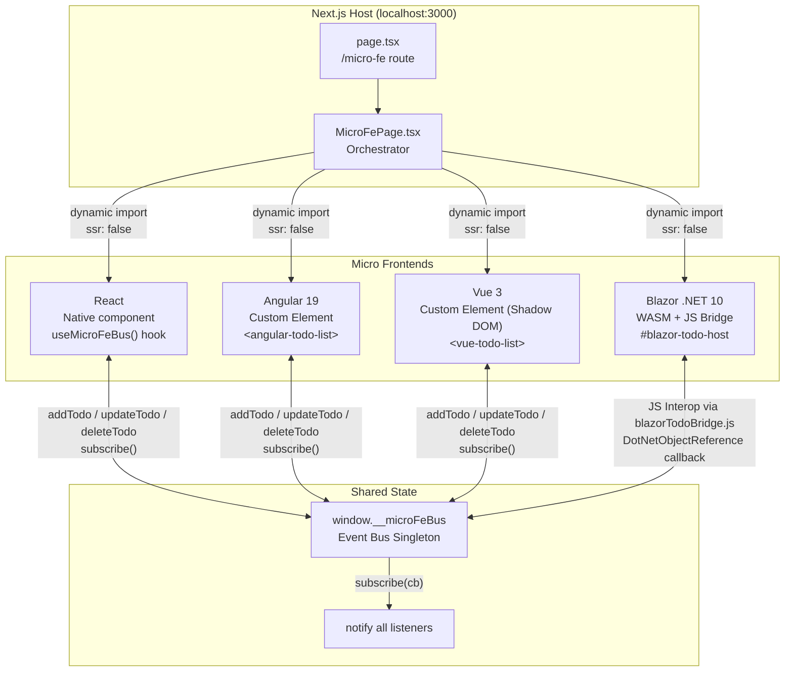

# Micro FE Architecture

## Architecture Diagram

## Data Flow

1. User performs action (add/edit/delete) in any micro FE
2. Micro FE calls `window.__microFeBus.addTodo()` / `updateTodo()` / `deleteTodo()`
3. Bus updates internal state and calls `notify()`
4. All subscribed callbacks receive the new `TodoState`
5. Each micro FE re-renders with the updated items

## Key Files

| File | Purpose |
|------|---------|
| `shared/microFeBus.ts` | Framework-agnostic event bus singleton |
| `shared/todoTypes.ts` | Shared TypeScript interfaces |
| `react-app/ReactTodoList.tsx` | Native React micro FE |
| `containers/AngularTodoContainer.tsx` | Loads Angular custom element |
| `containers/VueTodoContainer.tsx` | Loads Vue custom element |
| `containers/BlazorTodoContainer.tsx` | Loads Blazor WASM runtime |
| `apps/angular-todo/` | Angular 19 standalone project |
| `apps/vue-todo/` | Vue 3 + Vite project |
| `apps/blazor-todo/` | .NET 10 Blazor WASM project |
